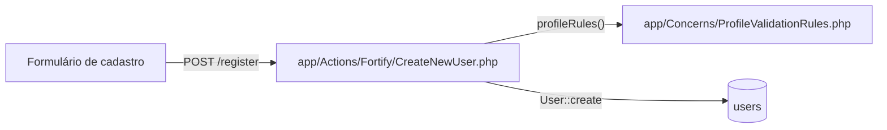
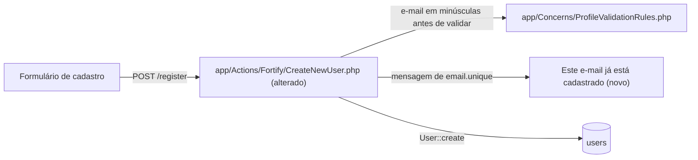

# Implementation Plan

Exemplo do curso (aula 4.3), escrito à mão no formato do planner do /plan (bc-harness 0.2.0), para o cadastro da aula 1.5. Não é saída de um /plan de verdade. O seu sai em `.spec/features/<slug>/PLAN.md`, ao lado da SPEC.md e do PHASES.md.

## Request Summary
- Objective: o cadastro recusa e-mail repetido, ignorando maiúsculas, e mostra "Este e-mail já está cadastrado" no campo de e-mail.
- Scope: in: cadastro por `POST /register` (starter kit do Laravel com Fortify). Out: convite, importação por CSV e login social.
- Tier: standard (4 critérios confirmados)
- Architecture references: `AGENTS.md`, `docs/agents/architecture.md`, `docs/agents/domain_rules.md`

## AS IS: componentes impactados

Hoje a regra unique compara o e-mail do jeito que ele chegou, e a mensagem do campo é a padrão do framework, em inglês.

## TO BE: componentes propostos

T01 altera o `CreateNewUser` para normalizar o e-mail antes da validação. T03 acrescenta a mensagem do `email.unique`. T02 e T04 ativam os testes de aceite.

## Tasks

### T01: E-mail em minúsculas antes de validar e de gravar
- **Files**: `app/Actions/Fortify/CreateNewUser.php`
- **Change**: trim e minúsculas no email do input antes do Validator; gravar o valor normalizado.
- **Covers**: RF-01, RF-02
- **Tests**: `tests/Feature/CadastroNormalizaEmailTest.php`: e-mail novo gravado em minúsculas; e-mail com outra caixa recusado.
- **Risk**: Medium: o banco pode já ter e-mails repetidos com caixa diferente.
- **Dependencies**: none

### T02: Ativar AC-02 no teste de aceite
- **Files**: `tests/Feature/CadastroEmailDuplicadoTest.php`
- **Change**: tirar o ->todo() do AC-02 e fazer passar.
- **Covers**: AC-02
- **Tests**: `tests/Feature/CadastroEmailDuplicadoTest.php`: AC-02.
- **Risk**: Low
- **Dependencies**: T01

### T03: Mensagem "Este e-mail já está cadastrado" para e-mail repetido
- **Files**: `app/Actions/Fortify/CreateNewUser.php`
- **Change**: mensagem de `email.unique` passada ao Validator; nenhuma outra mensagem muda.
- **Covers**: RF-03
- **Tests**: `tests/Feature/CadastroMensagemTest.php`: mensagem do unique; mensagem do required sem mudança.
- **Risk**: Low
- **Dependencies**: T01 (mesmo arquivo)

### T04: Ativar AC-03 e fechar o aceite
- **Files**: `tests/Feature/CadastroEmailDuplicadoTest.php`
- **Change**: tirar o ->todo() do AC-03 e fazer passar; AC-01 e AC-04 seguem ativos.
- **Covers**: AC-01, AC-03, AC-04
- **Tests**: `tests/Feature/CadastroEmailDuplicadoTest.php`: AC-01 a AC-04.
- **Risk**: Low
- **Dependencies**: T03

## Execution Phases
| Phase | Tasks | Parallel-safe? |
|-------|-------|----------------|
| 1 | T01, T02 | Não: T02 depende de T01 |
| 2 | T03, T04 | Não: T04 depende de T03, e T03 toca o mesmo arquivo de T01 |

## Risks
| Risk | Blast radius | Mitigation | Rollback |
|------|-------------|------------|----------|
| E-mails repetidos com caixa diferente já gravados | contas antigas | rodar o SELECT do FEATURE-ALVO.md antes; nada de índice único nesta feature | reverter o commit da fase 1 |

## Open Questions
- Normalizar os e-mails que já estão no banco? Fora do escopo desta feature; se o SELECT achar repetidos, vira outra feature.

## Assumptions
- O FEATURE-ALVO.md previa três fases (validação no backend, mensagem no formulário, e-mail em minúsculas). Aqui são duas: pôr o e-mail em minúsculas antes de validar é o que faz a regra unique recusar a outra caixa, então validação e minúsculas viram a mesma task (T01), na fase 1.
- `app/Actions/Fortify/CreateNewUser.php` é o ponto de cadastro, como no starter kit do Laravel com Fortify. [UNVERIFIED] no seu projeto.
- No starter kit atual, `config/fortify.php` vem com `lowercase_usernames => true`, e o AC-02 já passa. Nesse caso o T01 vira só conferência e o AC-02 nasce ativo. [UNVERIFIED] no seu projeto.
